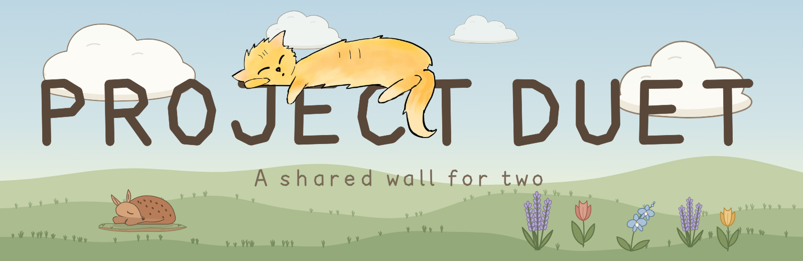
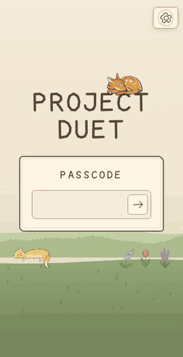
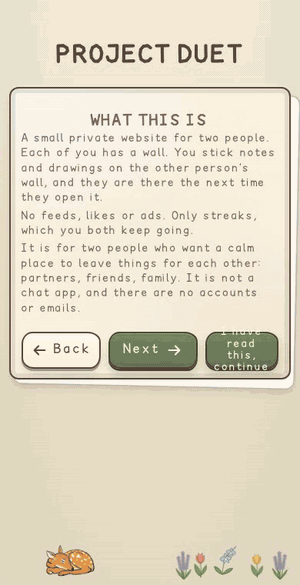
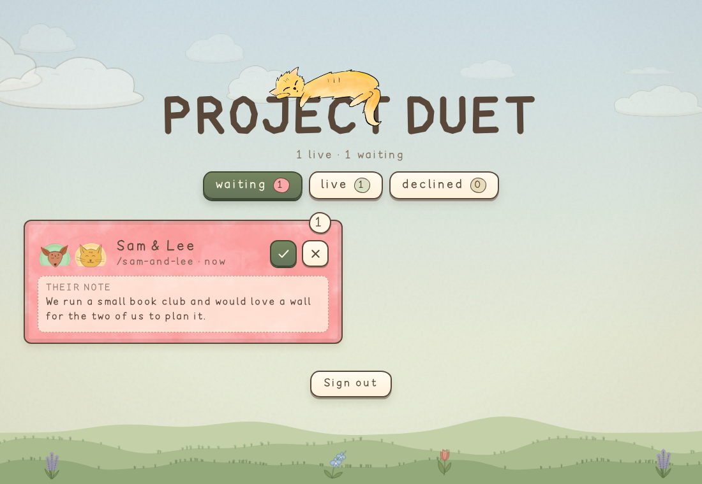
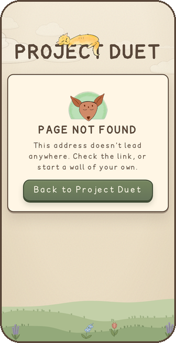
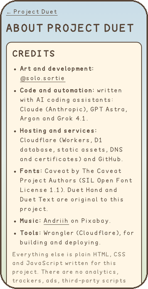
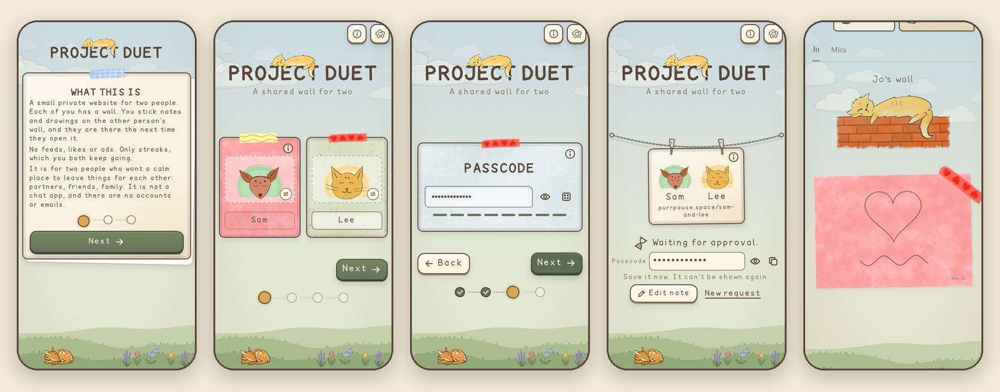
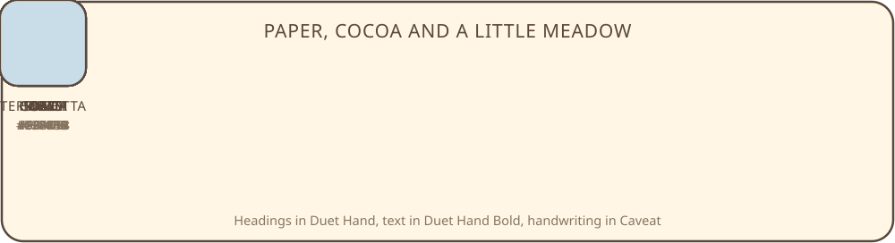

<p align="center">
  
</p>

<p align="center">
  <b>Leave each other notes and drawings. Keep a streak going.<br>No feeds, no likes, no ads, and no way for me to read what you write.</b>
</p>

<p align="center">
  
  
  
  
</p>

<p align="center">
  <a href="https://dash.purrpause.space"><b>Ask for a wall</b></a> &nbsp;·&nbsp;
  <a href="#how-it-works">How it works</a> &nbsp;·&nbsp;
  <a href="#your-notes-stay-yours">Privacy</a> &nbsp;·&nbsp;
  <a href="#run-it-yourself">Run it yourself</a> &nbsp;·&nbsp;
  <a href="#a-note-from-the-developer">Developer's note</a>
</p>

<p align="center">
  
</p>

<br>

## What it is

Project Duet is a small private website for two people. Each of you gets a wall. You stick notes and drawings on the other person's wall, and they are waiting there the next time that person opens it. That is the whole idea.

It is for partners, friends, family, anyone who wants a calm place to leave things for one other person. There is no chat, no feed and no account. You open your address, type a passcode you both know, and the wall is there. The sky outside the window follows the time of day, a cat and a deer keep you company, and a small flame counts the days you both keep showing up.

<br>

## How it works

### 1. Ask for a wall

Pick your names and an animal each, choose an address like `purrpause.space/coffee`, and set a passcode. Tap the dice if you want one made for you. Send the request.

<p align="center">
  
</p>

A few small things worth knowing, because they are easy to miss:

- The passcode is shown once, on the waiting screen, and the copy button copies the address and passcode together so you can send both in one message.
- While you wait you can add a short note for me (up to 400 characters). A line about who you are and what the wall is for is enough.
- Your passcode is never sent to the server. More on that [below](#your-notes-stay-yours).

### 2. I approve it

I read every request myself on a small review site and approve or decline it. That keeps the project small and calm, and it is why a request can take a little while. Once approved, your address starts working.

<p align="center">
  
</p>

### 3. Open it and start sticking

Go to your address, type the passcode, and choose who you are. Pick a pencil, ink or marker, write with the text tool, or fill the page. Choose paper (white, rose, sage or blue) and ink, then stick it to the wall. Unfinished pages become drafts, saved automatically, and you can come back to them from the Drafts shelf.

<table align="center">
  <tr>
    <td align="center"><br><sub>A friendly page for an address that leads nowhere</sub></td>
    <td align="center"><br><sub>Credits, license and privacy, on the front page</sub></td>
  </tr>
</table>

### The screens

<p align="center">
  
</p>

<br>

## Your notes stay yours

Notes, drawings and drafts are locked in your browser before they are sent, with a key made from your passcode. The server only ever stores the locked version, so I cannot read it, and neither could anyone who copied the database.

<p align="center">
  
</p>

In plain terms:

1. When you type the passcode, your browser stretches it (PBKDF2, 300,000 rounds) together with a public per-wall salt, and splits the result into a **login proof**, an **encryption key** and a small **repeatability key**.
2. Only the proof is sent to log in. The server stores a hash of it. The passcode and the key never leave the page.
3. Each note is sealed with AES-GCM before it is uploaded. What the server keeps looks like this, and nothing more:

```text
v1.s1qECPs2m3Pbw2kx.pU8rnZGaUMxDmym11oAW…
```

4. The other person types the same passcode, gets the same key, and opens it.

The code for all of this is one short file, [`public/vault.js`](public/vault.js), and the tests check the database directly: after a note, a large drawing or a draft is saved, [`worker/vault-test.mjs`](worker/vault-test.mjs) looks for the words you wrote and fails if it finds them.

### The honest limits

- Whoever has the address and the passcode can read the wall. A short passcode can be guessed by someone holding the database, so a longer one is safer.
- A lost passcode cannot be recovered, and neither can the notes locked with it. Nobody can unlock them, me included.
- Names, animals, addresses, who wrote a note and when, and your optional note to me are not locked. The site needs them to work.
- It runs on Cloudflare, which sees network traffic and keeps request logs like any host.
- The pages are code I serve, so a changed version could try to capture passcodes. The source is public so you can check what is being served.

<br>

## Under the hood

| | |
|---|---|
| **Server** | One Cloudflare Worker, serving the pages and a small JSON API |
| **Storage** | Cloudflare D1 (SQLite). Locked notes are stored as opaque text |
| **Front end** | Plain HTML, CSS and JavaScript. No framework, no build step |
| **Crypto** | The browser's Web Crypto: PBKDF2, HKDF, AES-GCM |
| **Tests** | `node:test` suites that run against a local Worker |
| **Fonts** | Duet Hand and Duet Text (original), Caveat for handwriting |

```text
public/            the pages
  vault.js         the encryption, in the browser
  dash/            front page and the request flow
  devsite/         the review site
  credits/         credits, license and privacy
  notice/          the 404 and error pages
worker/            the API, database migrations and tests
design/            scripts that generate the art and fonts
docs/media/        the pictures in this README
```

A few things I care about, quietly built in: rate limits on every guess and every request, with generous limits so normal use never notices them; security headers on every response; network addresses stored only as a salted hash; and no analytics, trackers, third-party scripts or web fonts of any kind.

<br>

## Run it yourself

You need Node 20 or newer.

```sh
npm install
cp .dev.vars.example .dev.vars     # local secrets for development
npm run db:local                   # create the local database
npm run dev                        # http://localhost:8787
```

The front page, the wall and the review site live on different host names. In Chrome, `localhost`, `dash.localhost` and `dev.localhost` all point at your machine, so open `http://dash.localhost:8787` to see the front page and `http://dev.localhost:8787` for the review site (the owner passphrase is `ADMIN_PASSPHRASE` in `.dev.vars`).

Run the tests with the dev server running in another terminal:

```sh
BASE=http://127.0.0.1:8787 npm test
```

To put your own copy online, follow [`DEPLOY.md`](DEPLOY.md). It covers the database, the secrets, the host names and search setup.

<br>

## How it looks

Everything is paper, cocoa and a little meadow. Headings are Duet Hand in capitals with a touch of stroke, text is Duet Hand Bold, and the handwriting on notes is Caveat.

<p align="center">
  
</p>

<br>

## License and credits

The code is open source under the **GNU AGPL-3.0** ([`LICENSE`](LICENSE)). You may read it, run it, change it and contribute. If you run a changed copy as a service, you must share your changes under the same license.

The **art, the Duet fonts, the name and the music are not part of that license.** The art, fonts and name are all rights reserved ([`ASSETS-LICENSE.md`](ASSETS-LICENSE.md)), so a fork needs its own. The music is by [Andriih](https://pixabay.com/users/andriih-56549121/) on Pixabay and is not in this repository. The site works without it. Caveat is by The Caveat Project Authors under the SIL Open Font License. Third-party notices are in [`NOTICE.md`](NOTICE.md).

Art and development by [@solo.sortie](https://instagram.com/solo.sortie). The code was written with AI coding assistants: Claude (Anthropic), GPT Astra, Argon and Grok 4.1. Hosting and services are Cloudflare and GitHub. The full credits live on the [front page](https://dash.purrpause.space/credits/).

Contributions are welcome. Please read [`CONTRIBUTING.md`](CONTRIBUTING.md) first.

<br>

## A note from the developer

Project Duet began as a private wall for two people: somewhere calm to leave things for someone, with nothing trying to pull either of us back. Every time I added something I asked whether it was a note, a drawing or a streak. If it was not, I left it out.

I draw the art, make the lettering and decide how everything should feel. I do not write the code alone. Much of it is written with AI coding assistants while I direct, review and test it, and I would rather say that plainly than leave you to wonder.

Two promises I try to keep. I cannot read your notes, and this repository is where you can check that I am telling the truth. And I approve every wall by hand and use the site myself, so it stays looked after. It runs on free hosting, so it can be slow, and I would rather tell you that than pretend.

If something is confusing, broken or unkind, tell me. If you build something with the code, I would love to see it. Please bring your own art and your own name.

Thank you for reading this far.

Aryan ([@solo.sortie](https://instagram.com/solo.sortie))

<p align="center">
  <br>
  <sub>Made slowly, with a cat and a deer.</sub>
</p>
